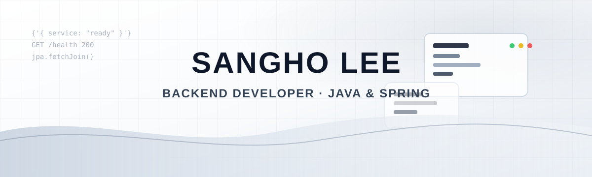
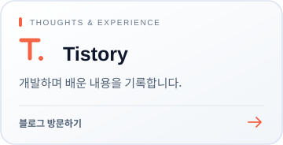
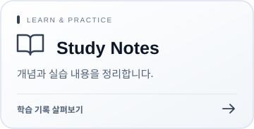
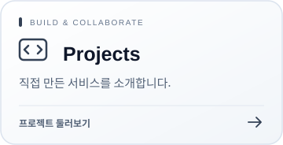

<picture>
  <source media="(prefers-color-scheme: dark)" srcset="https://raw.githubusercontent.com/DavidLee534/DavidLee534/main/assets/banner-dark-v5.svg" />
  
</picture>

<picture>
  <source media="(prefers-color-scheme: dark)" srcset="https://readme-typing-svg.demolab.com?font=JetBrains+Mono&weight=700&size=24&duration=3200&pause=900&color=E2E8F0&center=true&vCenter=true&multiline=false&repeat=true&width=620&height=40&lines=BACKEND%20DEVELOPER;Java%20%C2%B7%20Python%20%C2%B7%20Spring;CS%20%C2%B7%20Backend%20%C2%B7%20AI%20%C2%B7%20Tools;Learning%20by%20shipping" />
  
</picture>

**코드에서 실행 환경까지, 서비스의 흐름을 이해하는 개발자를 지향합니다.**

CS·백엔드·AI·협업 노트를 교재형으로 정리하며, 
로그와 데이터를 바탕으로 문제의 원인을 확인하는 습관을 쌓고 있습니다.

 

<picture>
  <source media="(prefers-color-scheme: dark)" srcset="https://raw.githubusercontent.com/DavidLee534/DavidLee534/main/assets/section-analytics-dark-v6.svg" />
  
</picture>

<picture>
  <source media="(prefers-color-scheme: dark)" srcset="https://github-readme-stats.vercel.app/api?username=DavidLee534&show_icons=true&hide_border=true&bg_color=0B1220&title_color=E2E8F0&icon_color=94A3B8&text_color=E2E8F0&border_radius=8" />
  
</picture>
<picture>
  <source media="(prefers-color-scheme: dark)" srcset="https://github-readme-stats.vercel.app/api/top-langs/?username=DavidLee534&layout=compact&hide_border=true&bg_color=0B1220&title_color=E2E8F0&text_color=E2E8F0&border_radius=8" />
  
</picture>

<picture>
  <source media="(prefers-color-scheme: dark)" srcset="https://streak-stats.demolab.com?user=DavidLee534&hide_border=true&background=0B1220&stroke=334155&ring=E2E8F0&fire=94A3B8&currStreakNum=E2E8F0&sideNums=E2E8F0&currStreakLabel=94A3B8&sideLabels=64748B&dates=64748B" />
  
</picture>

 

<picture>
  <source media="(prefers-color-scheme: dark)" srcset="https://ghchart.rshii.com/94A3B8/DavidLee534" />
  
</picture>

 

<picture>
  <source media="(prefers-color-scheme: dark)" srcset="https://raw.githubusercontent.com/DavidLee534/DavidLee534/main/assets/section-stack-dark-v6.svg" />
  
</picture>

**Languages**

  
  

**Backend**

  
  
  
  
  

**Tools & Environment**

  
  
  
  
  

 

<picture>
  <source media="(prefers-color-scheme: dark)" srcset="https://raw.githubusercontent.com/DavidLee534/DavidLee534/main/assets/section-projects-dark-v6.svg" />
  
</picture>

### 01 · Nyan Cafe
**카페 웹 서비스 | 팀 프로젝트**

서비스 대표 일러스트 · 저장소의 실제 이미지 자산

관리자 메뉴 도메인의 백엔드 개발을 담당했습니다.

- 메뉴 등록·조회·수정·삭제 API 구현
- 카테고리·상태 필터와 검색·페이지네이션 구현
- 완전일치 조회 조건을 수정해 메뉴 이름 부분검색 지원
- Hibernate 로그로 N+1 문제를 확인하고 fetch join 적용

  
  
  
  
  

### 02 · Resuit
**개발자 소통과 이력서 피드백을 연결하는 SNS | 팀 프로젝트**

시연용 가상 데이터로 구성한 실제 서비스 화면

개발자의 활동과 이력서 피드백, 기업의 인재 탐색을 연결하는 SNS입니다.

**담당 기능**

- 프로필 조회·수정, 위젯·경력·활동 탭과 대표 이력서 고정
- GitHub 기여·저장소 동기화와 블로그 RSS 소유권 검증·글 수집
- 현직자 인증 상태·대표 배지 표시 및 피드·댓글·피드백 배지 노출
- 피드백 게시판 목록과 상세 화면 연결, 기업 이메일 인증 취소

  
  
  
  
  

### 03 · Igloo
**개인 파일 서버 | 개인 프로젝트**

Java 내장 Tomcat과 Servlet으로 파일 서버를 구현했습니다.

- 파일 업로드·폴더 생성·파일 목록 조회 기능 구현
- Windows에서 서버를 실행하고 Mac에서 로컬 네트워크 접속 검증

  
  
  
  

 

### Currently Building · REMAKE

**영수증 OCR과 AI를 활용한 식재료·식단 관리 서비스 | 팀 프로젝트 진행 중**

영수증 인식, 냉장고 재료 관리, 맞춤 레시피와 주간 식단 추천을 목표로 개발하고 있습니다.

**현재 기여**

- 프론트엔드 lint·타입 검사·빌드 및 백엔드·프론트엔드 Docker 이미지 빌드 CI 추가
- PR 필수 CI 검사 기준 문서화
- GitHub Actions 기반 Campfire PR 알림과 이슈·PR 템플릿 구성

 

<picture>
  <source media="(prefers-color-scheme: dark)" srcset="https://raw.githubusercontent.com/DavidLee534/DavidLee534/main/assets/section-learning-dark-v6.svg" />
  
</picture>

| 주제 | 학습 방향 | 노트 |
| :--- | :--- | :--- |
| Computer Science | 자료구조 · 알고리즘 · OS · 네트워크 · DB 이론 · 설계 패턴 | [cs/](https://github.com/DavidLee534/dev-study/tree/main/cs) Ready |
| Backend | Spring · NestJS · FastAPI 병렬 (요청·DI·ORM·인증·테스트) | [backend/](https://github.com/DavidLee534/dev-study/tree/main/backend) Ready |
| AI / ML | 학습·평가·임베딩 · LLM · RAG · 에이전트 (Python 스니펫) | [ai/](https://github.com/DavidLee534/dev-study/tree/main/ai) Ready |
| Collaboration | Git · PR · 리뷰 · 문서 · IDE · CI 습관 | [tools/](https://github.com/DavidLee534/dev-study/tree/main/tools) Ready |
| Languages | Java, Python 문법과 실습 | [language/](https://github.com/DavidLee534/dev-study/tree/main/language) |
| Next | Frontend · Database · Infra · Security 교재화 | Outline 예정 |

### Study Notes · 학습 기록

개념을 이해하고 직접 실습한 내용을 주제별로 정리합니다.  
교재형 노트: **CS · Backend · AI · Tools** Ready.

 

<picture>
  <source media="(prefers-color-scheme: dark)" srcset="https://raw.githubusercontent.com/DavidLee534/DavidLee534/main/assets/footer-dark-v6.svg" />
  
</picture>
